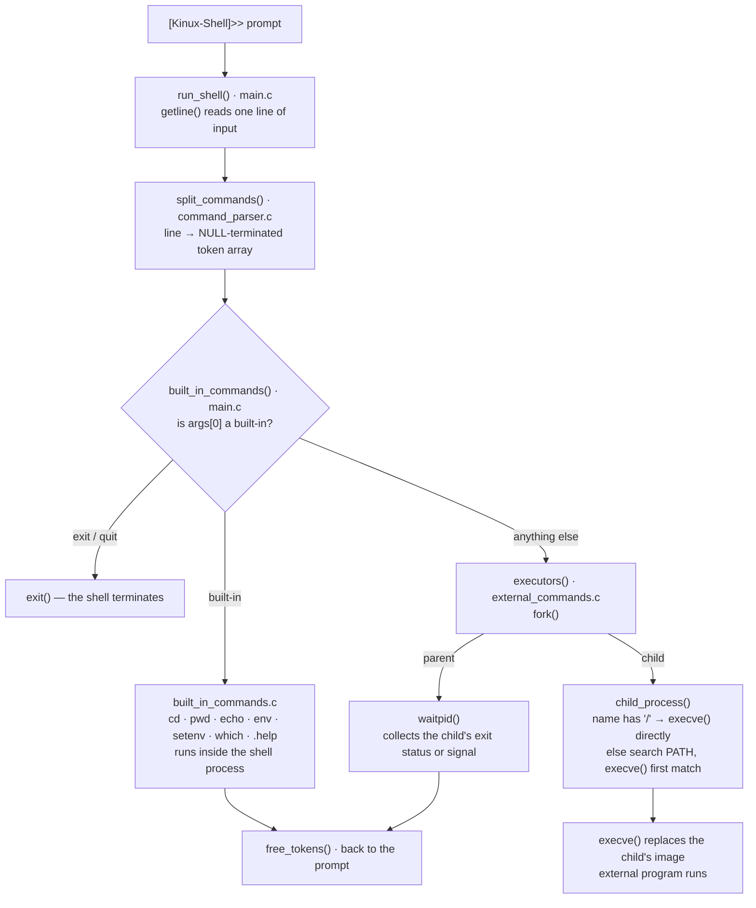
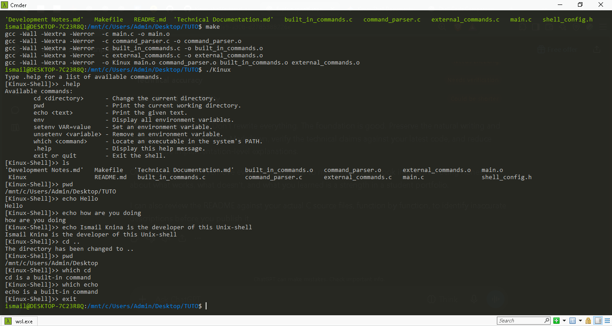

# Kinux-Shell

> A Unix-like command-line shell implemented in C


Kinux-Shell is a Unix-like shell written in C. It shows a prompt, reads commands from standard input, and executes them — built-in commands run inside the shell process itself, while external programs run in child processes created with `fork()` and replaced with `execve()`.

I built it to understand the pieces a real shell is made of: tokenizing input by hand, managing dynamic memory carefully, creating and waiting for processes, resolving executables through `PATH`, and handling the environment. It runs on Linux. It's a learning project and deliberately minimal — no pipes, no redirection, no job control.

## Overview

A command goes through four steps:

1. **Read** — `run_shell()` reads one line with `getline()`.
2. **Parse** — `split_commands()` turns the line into a NULL-terminated array of tokens.
3. **Dispatch** — if the first token is a built-in (`cd`, `pwd`, `echo`, `env`, `setenv`, `which`, `.help`, `exit`), the shell runs it directly in its own process.
4. **Execute** — anything else is treated as an external program: `fork()`, then `execve()` in the child and `waitpid()` in the parent, then back to the prompt.

Built-ins never fork, because they can't: `cd` changes the *shell's* working directory, and a child process could only ever change its own.

## Demo
A short demonstration of Kinux-Shell in action:

https://github.com/user-attachments/assets/64fcd054-8bed-458c-922d-803e63cffbf2

## Features

**Command parsing**

- Hand-written whitespace tokenizer (`split_commands`): builds a NULL-terminated `char **` array of tokens
- Splits on spaces, tabs, newlines, carriage returns and bell characters; over-long commands are rejected gracefully instead of overflowing
- Every token is individually heap-allocated and fully released after each command

**Built-in commands** — executed inside the shell process

- `cd <dir>` — changes the working directory with `chdir()`
- `pwd` — prints it with `getcwd()`
- `echo [-n] text...` — prints arguments and expands `$VAR` from the shell's own environment
- `env` — lists environment variables
- `setenv VAR=value` or `setenv VAR value` — adds a variable, both syntaxes supported
- `which <cmd>` — reports built-in status, or locates the executable in `PATH`
- `.help` / `help` — command list · `exit` / `quit` — leave the shell

**External command execution**

- Foreground execution with `fork()` + `execve()` + `waitpid()`
- Commands containing a path (`./program`, `/bin/ls`) execute directly
- Manual `PATH` search — no `execvp()`: candidate paths are built, checked with `access(X_OK)`, and the first match is `execve()`'d
- The child's exit status is collected, and signal termination is reported with the `128 + signal` convention

**Environment variables**

- The shell keeps its own environment array, separate from the system's `environ`
- `setenv` rebuilds that array and swaps it in (via a `char ***` parameter), and the current view is passed to every child process through `execve()`'s `envp`

## Technologies

| Technology | Role in the project |
|---|---|
| C | Implementation language — standard C plus POSIX interfaces |
| GCC | Compiler, built warning-free with `-Wall -Wextra -Werror` |
| GNU Make | Build automation: `make`, `clean`, `fclean`, `re` |
| POSIX system calls | `fork`, `execve`, `waitpid`, `getcwd`, `chdir`, `access` |
| Standard C library | `getline`, `malloc`/`free`/`strdup`/`realloc`, `<string.h>` utilities |

## Architecture



Two design points behind the diagram:

- **Built-ins run in the shell's own process.** Per-process state — the working directory, the environment — can only be changed by the process that owns it.
- **The shell owns its environment.** `setenv` receives `char ***` so the dispatcher can replace the whole array, which is also why `echo $VAR` scans that array by hand instead of calling `getenv()` — after the first `setenv`, the system's `environ` no longer matches what the shell sees.

## Installation and Compilation

### Requirements

- Linux, or any POSIX system — developed and tested on Ubuntu
- GCC and GNU Make

It won't build on Windows: I tried the MSYS2 UCRT64 environment first and `<sys/wait.h>` isn't available there. A real POSIX system is what this targets.

### Build and run

```bash
git clone https://github.com/Ismailknina/Kinux-shell.git
cd Kinux-shell
make
./Kinux
```

| Target | Effect |
|---|---|
| `make` | Builds the `Kinux` executable |
| `make clean` | Removes object files |
| `make fclean` | Removes object files and the executable |
| `make re` | Full rebuild from scratch |

## Usage

An example session (paths and listings will differ on your machine):

```text
[Kinux-Shell]>> pwd
/home/ismail/projects/kinux-shell
[Kinux-Shell]>> echo Hello world
Hello world
[Kinux-Shell]>> setenv GREETING=hello
[Kinux-Shell]>> echo $GREETING
hello
[Kinux-Shell]>> which ls
/usr/bin/ls
[Kinux-Shell]>> ls -l
total 48
-rwxr-xr-x 1 ismail ismail 25344 Nov 12 10:30 Kinux
...
[Kinux-Shell]>> cd /tmp
The directory has been changed to /tmp
[Kinux-Shell]>> exit
```

 

## Project Structure

```text
Kinux-shell/
├── main.c                      # Entry point — read–parse–execute loop, dispatcher, help text
├── command_parser.c            # Tokenizer — split_commands() / free_tokens()
├── built_in_commands.c         # Built-ins — cd, pwd, echo, env, setenv, which (+ PATH lookup for which)
├── external_commands.c         # Process execution — fork/execve/waitpid + PATH helpers
├── shell_config.h              # Shared header — includes, MAX_INPUT_SIZE, all prototypes
├── Makefile                    # Build rules — all, clean, fclean, re
├── Development Notes.md        # My learning log — questions, discoveries, decisions
├── Technical Documentation.md  # Function-by-function explanation of the implementation
└── README.md
```

## What I Learned

- **Pointers to pointers.** `char **` for token arrays, and `char ***` for `setenv` — passing the address of a pointer so the callee can replace the pointer itself, not a copy of it.
- **Manual memory management.** Two-level allocation (one array of pointers, one string per token), freeing strings before the array that references them, rolling back partial work when an allocation fails mid-way, and the `realloc` temp-pointer idiom.
- **C string handling.** Writing a tokenizer from scratch; why `strtok()` needs a `strdup()` copy first (it mutates what it splits); matching exact variable names with a prefix check plus a `'='` boundary test; `snprintf()` over `sprintf()`.
- **Processes.** `fork()` is called once but returns twice; `execve()` doesn't create anything — it replaces the running program and never returns on success; `waitpid()` decodes status with `WIFEXITED` / `WIFSIGNALED`; why a forked child should call `_exit()` instead of `exit()`.
- **Why built-in commands exist.** Per-process state (working directory, environment) can only be modified by the process that owns it.
- **Environment internals.** The layout of `environ`, and the gap that opens between the system's environment and the shell's private copy after the first `setenv`.
- **Multi-file C projects.** Header guards, prototypes vs definitions, forward declarations.
- **Build discipline.** Makefile variables and pattern rules, incremental builds, and compiling clean under `-Wall -Wextra -Werror`.
- **POSIX vs ISO C.** Which functions come from where — and what porting actually breaks, which the missing `<sys/wait.h>` in MSYS2 taught me firsthand.

The function-by-function version of all of this is in the [Technical Documentation](https://github.com/Ismailknina/Kinux-shell/blob/main/TECHNICAL_DOCUMENTATION.md).

## Known Limitations

- `unsetenv` is implemented in `built_in_commands.c`, but the dispatcher has no branch for it yet — typing `unsetenv VAR` falls through to the external executor and fails, even though `.help` advertises it.
- The parser is a plain tokenizer: no quotes, pipes, redirection or globbing, so arguments can't contain spaces.
- No signal handling (Ctrl+C terminates the shell), no background execution (`&`), and no `$?` — the exit status is collected but the main loop currently discards it.
- `setenv` appends without replacing: `setenv PATH=...` twice leaves two `PATH` entries, and each successful call abandons the previous environment array — a bounded, documented leak.
- `cd` has no `$HOME` fallback and reports success even when `chdir()` fails.
- The executor tries the current directory even when it isn't in `PATH` — real shells skip that for security reasons.

## Possible Improvements

Identified while building the project — candidates, not commitments:

- Wire `unsetenv` into the dispatcher and make `setenv` replace existing variables.
- Add quoting, pipes and redirection to the parser.
- Install a `SIGINT` handler at the prompt and implement `$?`.
- Add a `$HOME` fallback for `cd`, and a `cd -` using the initial directory the shell already captures.
- Replace the two parallel `PATH` search implementations with one shared helper.
- Track environment-string ownership so `setenv` stops abandoning the old array.
- Write my own versions of library functions like `strcmp()`.

## Documentation

- **[Development Notes.md](Development%20Notes.md)** — my working notes from building the project: the questions I had, what didn't make sense at first, what clicked, and the decisions behind the implementation.
- **[Technical Documentation.md](Technical%20Documentation.md)** — the structured technical explanation of the final implementation: architecture, each source file, memory management, command execution, and the systems-programming concepts behind them.

## Author

**Ismail Knina** — Computer Science Student | Software Development | Systems Programming

Second-year Computer Science student at Ibn Tofail University, Morocco.

- GitHub: [@Ismailknina](https://github.com/Ismailknina)
- LinkedIn: [LINKEDIN_PROFILE_URL]  <!-- TODO: replace with your LinkedIn profile URL -->
